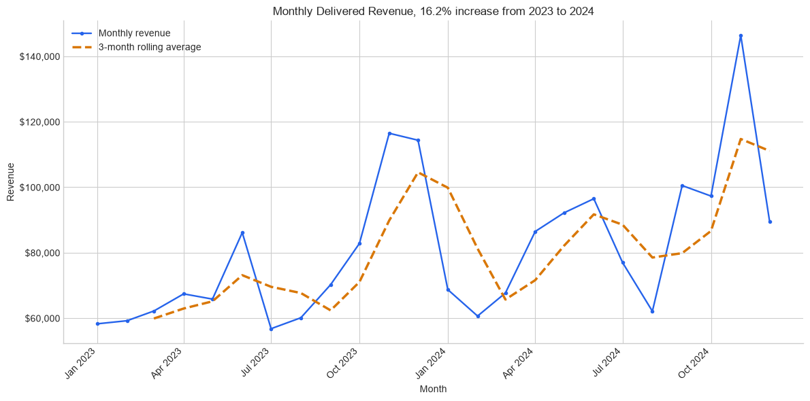
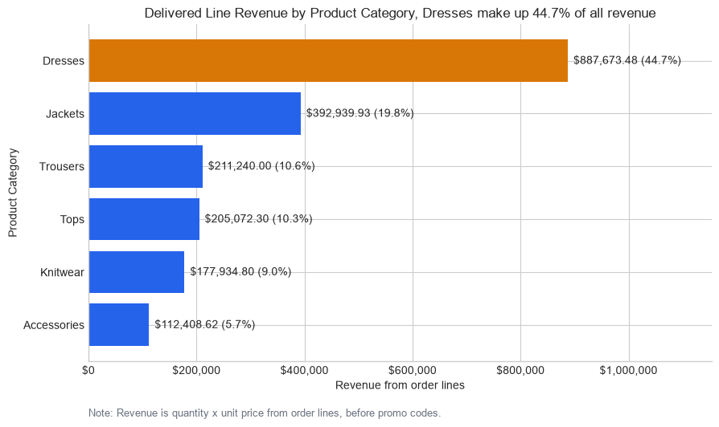

# Maison Lune Online Fashion Retailer Sales Analysis

The purpose of this project is to analyze data from a fictional online store 'Maison Lune'.  This project utilizes python to perform the analysis; the packages used include pandas, numpy, matplotlib, and seaborn.  Additional notes, analysis and code can be found in the Jupyter notebook.

## Data

Four tables, 9,810 order rows before cleaning (9,780 orders), 19,714 order lines, 992 SKUs, 3,066 returned lines, January 2023 to December 2024.

[Link to data cleaning observations and decisions](https://github.com/hamyqueso/maison-lune-analysis/blob/main/data_quality.md)

## Key Findings

1. Revenue increased 16.15% from 2023 to 2024 but Black Friday week revenue increased by 52.0% from 2023 to 2024. Perhaps people are looking for more deals so if there is a good deal they are likely to spend more. We could offer more deals throughout the year rather than just during Black Friday week.

2. 70% of orders were placed by one time customers. Getting customers to place one order is the most difficult thing so retaining these customers is highly important to increasing sales. One idea is to give customers a coupon after their first purchase so incentivize a second purchase.

3. 40 styles out of a total of 120 make up 80% of the store's revenue. One style (Elise Wrap Dress) accounted for 24.37% of the store's revenue. First it's importnat not to let that style go out of stock otherwise we would take a large loss in revenue. Second, we could look into why this particular style sells so well with customers. Could we add more styles that are similar to this one?

4. French customers account for 45.1% of revenue. We may want to increase marketing in other countries to increase sales. One thing that is surprising is that the United States is not listed as a country in the sales data. Is there a reason that we are not selling to the US? This could be a large market that we have not accessed yet.

5. App sales accounted for 38.2% of the revenue while web sales accounted for 61.8% of revenue. At present web sales still bring in the majority of the revenue but we are seeing an increase in app sales from 2023 to 2024 (3.2% increase).  Perhaps more people are finding that purchasing on the app is more convenient. If more people had our app we could increase sales, so one idea is to offer some coupon for ordering through the app.

6. The majority of activity is on the weekend (34.4%) and at night between the hours of 8PM-11PM (33.4%). If most customers are active during those times we could maybe do some flash sales during those times to increase orders placed.

## Charts

## Decisions

* Duplicate orders: There were 30 rows in orders that were exact duplicates.  These were removed to avoid double counting revenue.
* Order statuses: Statuses in the orders table were normalized for accurate order sorting. Only delivered orders counted towards the total revenue number.
* Missing order_totals: Missing order_total values were added in using data from the order_lines table in order to get a more accurate representation of revenue for the store.  The added order totals did not apply any discounts which may cause mismatch of calculated revenue compared to actual revenue.
* Revenue source: For revenue calculations, the order_total column in the orders table was used instead of the order_lines table. As stated above, the order_lines table does not account for any discounts the customer may receive when placing the order.
* Colors, styles, and sizes: The products table was left unchanged. Initially there seemed to be many duplicate rows but in actuality these rows included the same style and color but a different garment size.
* One change: In order to ensure a correct calculation of the store's revenue, I would recommend that the order_totals are calculated using any discount the customer receives.

## Interview script

**What problem did you work on, and for whom?**

The owners of the online store Maison Lune wanted to explore their sales data and determine trends over a two year period. I looked at revenue growth, customer order trends, popular clothing styles, and app vs. website sales.

**What data did you use, and what are its limits?**

I used data from the shop systems. This data consisted of four spreadsheets containing data for orders, order lines, products, and returns.  The orders table had some issues that required some data cleaning and imputation. For example, there were duplicate rows (exact duplicates), missing values in the order_total column, and typos in the order_status column.

**How did you go about it, and why that way?**

30 duplicate rows were removed from orders which removed $7598.49 in false revenue. There was also missing data in some of the order_totals. There were several options for how to deal with this but I decided to calculate the missing values from the order_lines table. Filling in the missing data added $15,264.69 in revenue. This might be more accurate than leaving the missing data blank but there is a possibility that calculating the order revenue this way missed some information such as discounts or sales tax.

**What did you find? Give the key number.**

I found that revenue is increasing from year to year. The store made $145266.43 more in 2024 compared to 2023, a 16.15% increase.  We can also see that during November (which includes Black Friday a major shopping holiday) the revenue was up by 28.02% from 2023 to 2024.  Another interesting data point is that while only 30.1% of customers are repeat customers, they make up 57.87% of the revenue earned by the store.

**How do you know it is right?**

I checked that there were no more duplicate order ids, that the order statuses were all normalized, and that there were no missing values in the order_total column (filled with data calculated from order_lines).  This insured that all the data would properly utilized by the query.

**With one more day, what would you do?**

I might try to ensure that my was of filling the missing order_totals was the correct way to do so. Some orders also had some promo codes applied so that would affect the actual order total in the end, but for this project I decided to leave the filled order_totals as is.

**What did you hand to an AI assistant, and what did you check yourself?**

The majority of the code was written by the AI agent. I would ask the agent what I wanted to see and I would check the output and make any necessary changes depending on if the AI agent misunderstood my instructions.
